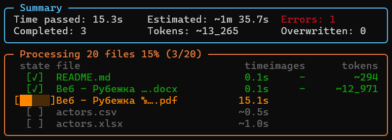
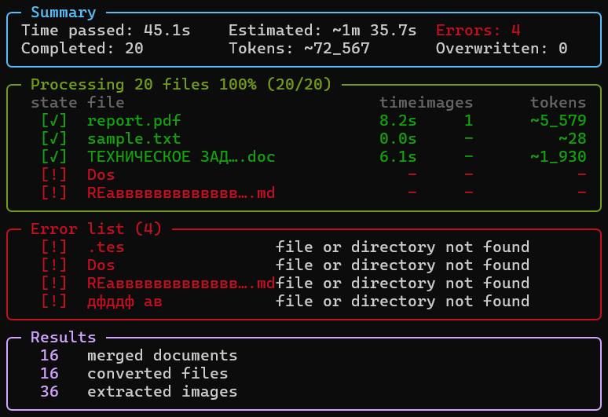

# hammerdown

[](https://github.com/sergeypugin/hammerdown/actions)
[](https://pypi.org/project/hammerdown/)
[](https://github.com/sergeypugin/hammerdown/releases)
[](https://www.python.org/)
[](https://github.com/sergeypugin/hammerdown/releases)
[](CONTRIBUTING.md)

<div align="center">
  
</div>

`hammerdown` is a cross-platform tool and Python library for converting PDF, Word, Excel, PowerPoint, OpenDocument, CSV, and plain-text documents into clean Markdown. Embedded images, SVG charts, and mathematical formulas are automatically extracted and formatted.

The PDF pipeline is built on [PyMuPDF](https://pymupdf.readthedocs.io/) and [PyMuPDF4LLM](https://github.com/pymupdf/PyMuPDF4LLM), which do the actual page-layout reconstruction and Markdown generation. This is the central feature the project was built around. Everything else -- routing, batch handling, merging, and file-manager integration -- is built around that core.

## Supported Formats

- **PDF and E-books**: `.pdf`, `.epub`, `.mobi`, `.fb2`, `.xps`
- **Word and OpenDocument**: `.docx`, `.doc`, `.odt`
- **Spreadsheets**: `.xlsx`, `.xls`, `.csv`
- **Presentations**: `.pptx`, `.ppt`
- **Text and Markdown**: `.txt`, `.md`, `.log`

> [!important]
> Legacy binary formats (`.doc`, `.xls`, `.ppt`) require a compatible desktop office suite installed on the same computer as `hammerdown`. These applications are not bundled with `hammerdown`.
>
> - on Windows, the matching desktop Microsoft Office application is tried first, then LibreOffice
> - on Linux and macOS, LibreOffice is required
>
> Modern formats (`.docx`, `.xlsx`, `.pptx`) are processed without an external office suite.

## Table of Contents

- [Output Directory Layout](#output-directory-layout)
- [Installation](#installation)
  - [Recommended: Python package (pip)](#recommended-python-package-pip)
  - [Direct Download (Standalone binaries)](#direct-download-standalone-binaries)
  - [File Manager Context Menu Integration](#file-manager-context-menu-integration)
  - [Logging and Progress Tracking](#logging-and-progress-tracking)
- [Advanced Usage](#advanced-usage)
  - [Command Line Interface](#command-line-interface)
    - [Merging Documents into a Single File](#merging-documents-into-a-single-file)
    - [Streaming to stdout](#streaming-to-stdout)
  - [Python Library Quickstart](#python-library-quickstart)
- [Implementation Notes](#implementation-notes)
  - [Extracting Base64 Images from Markdown](#extracting-base64-images-from-markdown)
  - [Math Formulas and Symbol Normalization](#math-formulas-and-symbol-normalization)
  - [Tables and Spreadsheets](#tables-and-spreadsheets)
- [Credits and Attribution](#credits-and-attribution)
- [Documentation links](#documentation-links)

## Output Directory Layout

Output Markdown files are named after the source document, so `report.docx` becomes `hm_report_docx.md` and `notes.txt` becomes `hm_notes_txt.md`. The source extension is part of the name, which keeps `report.docx` and `report.doc` from overwriting each other.

**Before conversion:**

```text
folder/
└── report.docx
```

**After conversion:**

```text
folder/
├── report.docx
├── hm_report_docx.md
└── hm_images_report_docx/
    └── chart_000.svg
```

PDF text is converted directly to Markdown without producing an asset folder; images and charts are extracted for Word, OpenDocument, Markdown, and presentation sources, where the source format exposes them as separate assets.

## Installation

### Recommended: Python package (pip)

If Python (3.10+) is installed on your system, install via pip:

```sh
pip install hammerdown
```

Or install from local source:

```sh
git clone https://github.com/sergeypugin/hammerdown.git
cd hammerdown
pip install .
```

### Direct Download (Standalone binaries)

If you do not have Python installed, precompiled standalone binaries are available on the [GitHub Releases page](https://github.com/sergeypugin/hammerdown/releases) or you can download directly from the links below:

| OS | Download |
| :--- | :--- |
| **Windows** | [](https://github.com/sergeypugin/hammerdown/releases/latest/download/hammerdown-windows-x64.exe) |
| **Linux** | [](https://github.com/sergeypugin/hammerdown/releases/latest/download/hammerdown-linux-x64) |
| **macOS** | [](https://github.com/sergeypugin/hammerdown/releases/latest/download/hammerdown-macos-x64) [](https://github.com/sergeypugin/hammerdown/releases/latest/download/hammerdown-macos-arm64) |

On Linux and macOS, make the downloaded binary executable before running:

```sh
chmod +x ./hammerdown-linux-x64
./hammerdown-linux-x64 --version
```

### File Manager Context Menu Integration

You can integrate `hammerdown` directly into your OS file manager to convert documents with a single right-click, without opening a terminal:

```sh
hammerdown --install
```

What this does:

- on Windows: adds a **Hammer down file** action with an icon to the File Explorer context menu for all supported document formats, adds folder context menu options for recursive directory conversions, creates a **Send to** shortcut (`Send to -> Hammer down`) for first-level access in Windows 11, and activates an IPC coordinator to process multi-file selections in a single terminal window
- on Linux: installs the launcher into `~/.local/bin`, installs a FreeDesktop application entry in `~/.local/share/applications/hammerdown.desktop` with MIME associations, registers KDE Dolphin ServiceMenus in `~/.local/share/kio/servicemenus` and `~/.local/share/kservices5/ServiceMenus`, and adds scripts for Nautilus, Nemo, and Caja (`Scripts -> Hammer down file`)
- on macOS: installs the launcher into `~/.local/bin`, creates an Automator Quick Action in `~/Library/Services/Hammer down.workflow` for the Finder right-click context menu, and generates a drag-and-drop Droplet in `~/Applications/Hammer down.app` with `CFBundleDocumentTypes` for Finder "Open With"

To convert a file or folder, right-click any supported document or folder and select **Hammer down file** (or use **Send to -> Hammer down**). The Markdown output and extracted images are saved directly next to each original document.

To remove file manager integration and clean up shortcuts:

```sh
hammerdown --uninstall
```

To update `hammerdown` to the latest version:

```sh
hammerdown --update
```

> [!warning]
> **Legacy version ambiguity (versions below 2.0.0):** due to a release synchronization conflict on version 1.5.2, run the clean recovery sequence below to avoid environment inconsistencies:
>
> ```sh
> pip uninstall hammerdown -y
> pip install --no-cache-dir hammerdown
> hammerdown --install
> ```
>
> Starting from version 1.5.2, `hammerdown --update` automatically refreshes all launcher scripts and file manager integrations without manual reinstallation. Release tags on GitHub are protected by immutable tag rulesets (`Protect release tags`).

### Logging and Progress Tracking

When converting documents from the terminal, `hammerdown` renders a live view instead of scrolling log lines. The `Summary` panel shows elapsed time, the preflight estimate, completed files, the running token count, and the number of errors. The `Processing` panel keeps a sliding window of the file queue:

<div align="center">
  
</div>

- a completed file gets a green marker and its duration, image count, and token count
- the active file shows an inline progress bar, the current page or slide count, and live elapsed time
- queued files are dimmed and show their preflight estimate
- failed files get a red marker and are repeated in a separate `Error list` panel with the failure reason
- panel borders are orange while the batch is running and green once it finishes
- the `Results` panel summarizes merged documents, converted files, and extracted images

<div align="center">
  
</div>

In non-interactive environments (CI pipelines, redirected logs, or non-TTY outputs) no live view is drawn. Each file is announced when it starts, and the same `Summary`, `Error list`, and `Results` panels are printed once at the end as plain text without terminal control characters:

```text
Processing report.pdf ~8.1s...
Processing notes.txt ~0.5s...
```

When using `hammerdown` as a Python library, custom progress callbacks can be passed to `to_markdown()` or `convert_file()`:

```python
def on_progress(current: int, total: int, unit: str):
    print(f"Processed {current}/{total} {unit}")

hammerdown.convert_file("report.pdf", progress_callback=on_progress)
```

## Advanced Usage

### Command Line Interface

Convert one or multiple files:

```sh
hammerdown report.pdf
hammerdown report.docx workbook.xlsx slides.pptx
```

Options:

- `-i`, `--include REGEX` -- only process files whose normalized relative path matches REGEX; may be repeated
- `-e`, `--exclude REGEX` -- skip files whose normalized relative path matches REGEX; may be repeated; exclusions always take priority
- `-w`, `--overwrite` -- overwrite plain-text source files (`.txt`, `.md`) in-place instead of creating a copy
- `-s`, `--skip-existing` -- skip conversion if the target Markdown file already exists (overwriting is enabled by default)
- `-o`, `--output-dir DIR` -- save Markdown output and extracted images under DIR, preserving the relative layout of the input tree
- `-m`, `--merge OUTPUT_MD` -- merge every converted Markdown document into a single target Markdown file
- `--stdout` -- write the merged Markdown document to stdout; diagnostics and errors go to stderr
- `--confirm` -- with `--stdout`, print a preflight estimate and ask for confirmation before writing anything
- `-v`, `--version` -- display version information

> [!note]
> The `-f` / `--force`, `--in-place`, and `--quiet` flags are not supported. Long option names use hyphens, so `--skip_existing` is rejected; use `--skip-existing` instead.

Include and exclude filters are applied to the path relative to the directory that was passed on the command line. Include narrows the recursive scan first, then exclude removes matches from that set:

```sh
hammerdown -i 'reports/.*' -e '/draft/' folder/
hammerdown -s report.pdf
```

#### Merging Documents into a Single File

`-m` / `--merge` converts many documents and concatenates the results into one Markdown file. This is convenient when you want to feed a whole project folder into an LLM as a single context block:

```sh
hammerdown -m summary.md project/report.pdf project/notes.docx project/drafts/
```

The target file is built incrementally and has two parts.

First, a directory tree of every source document, relative to their common root:

```text
Directory structure:
└── project/
    ├── report.pdf
    ├── notes.docx
    └── drafts/
        └── plan.md
```

Then one block per document. Each block starts with a line of 48 `=` characters, a `FILE:` line with the path relative to the common root, the same separator again, and the converted Markdown:

```text
================================================
FILE: report.pdf
================================================
# Quarterly Report

Revenue grew by 12% in Q3.

================================================
FILE: drafts/plan.md
================================================
# Draft Plan

- collect metrics
- review results
```

Key properties:

- output is written as the batch runs, so a partially converted file is still usable if the run is interrupted
- extracted assets are not mixed with the originals: for the target `summary.md`, images, charts, and decoded pictures are written into `hm_merged_into_summary_images/` next to the target, in subfolders that mirror each document's relative path, and their links are rewritten accordingly
- `--merge` is rejected together with `--overwrite` and with `--output-dir`, so plain-text sources are never modified during a merge
- combined with `-s` / `--skip-existing`, the whole merge is skipped when the target file already exists
- the merge target cannot also be one of the source documents

After the run the sources stay where they were, and the merged file sits next to its assets:

```text
project/
├── report.pdf
├── notes.docx
├── drafts/
│   └── plan.md
├── summary.md
└── hm_merged_into_summary_images/
    ├── hm_images_notes_docx/
    │   └── chart_000.svg
    └── drafts/
        └── hm_images_plan_md/
            └── embedded_img_0.png
```

#### Streaming to stdout

`--stdout` produces the same merged document as `-m`, but writes it to stdout instead of a file, and does not create any intermediate `hm_*.md` files:

```sh
hammerdown --stdout project/ > summary.md
```

Assets are inlined as base64 data URIs, so the stream is self-contained. Progress tables and per-file messages are suppressed; errors go to stderr, and the exit code is non-zero when any document failed.

Add `--confirm` to inspect the cost before anything is printed. Missing paths are reported first, then the preflight line shows the file count, a token estimate for text sources, and an estimated duration. The prompt accepts `y` and `yes`, rejects `n` and `no`, and re-asks on anything else:

```text
[!] drafts/: file or directory not found
[!] missing.md: file or directory not found
Preflight: 16 files, ~2_400 tokens from text sources, estimated time ~1m 43.9s.
Continue and write Markdown to stdout? [y/n] Lk
Please answer "y" or "n".
Continue and write Markdown to stdout? [y/n] nO
Cancelled.
```

Only formats that are already plain text (`.txt`, `.md`, `.log`, `.csv`) contribute to the token estimate, because the size of a PDF, DOCX, or XLSX says nothing about the Markdown that comes out of it. When an input contains no such files, the token clause is omitted. `--confirm` requires an interactive stdin; without a terminal it cancels safely instead of waiting. `--stdout` is incompatible with `--merge`, `--output-dir`, `--overwrite`, and `--skip-existing`.

### Python Library Quickstart

Use `hammerdown` directly in your Python code:

```python
import hammerdown

# Convert a file on disk
hammerdown.convert_file("report.pdf", skip_existing=True)

# Get Markdown text in memory
text, image_count = hammerdown.to_markdown("report.docx")

# Convert a batch with CLI-equivalent options
hammerdown.convert_files(["project/"], merge="summary.md", include=[r"reports/.*"])
```

For specialized format converters and low-level helpers, see [docs/PYTHON.md](docs/PYTHON.md).

## Implementation Notes

### Extracting Base64 Images from Markdown

If you have a Markdown file with embedded base64 images, running `hammerdown` with `--overwrite` extracts each image using its MIME type (`png`, `jpeg`, `webp`, `gif`, `svg` and other supported image subtypes) into a sibling folder named after the source. For `LMS.md`, the first decoded image is written as `hm_images_LMS_md/embedded_img_0.png` and the link in the document is rewritten to that path. The image is not converted to PNG: PNG is used only when the source data URI says `image/png`.

```sh
hammerdown LMS.md --overwrite
```

### Math Formulas and Symbol Normalization

Equations inside Word and OpenDocument files are automatically translated into standard LaTeX syntax. Special math characters and Greek letters are mapped using a catalog aligned with official LaTeX references:

- Official Reference: [Rice University LaTeX Symbols Reference](https://cmor-faculty.rice.edu/~heinken/latex/symbols.pdf)
- Bundled Copy: [symbols.pdf](symbols.pdf)

### Tables and Spreadsheets

Tables are reconstructed as real Markdown tables instead of loose text:

- **CSV**: the delimiter is detected from the first lines (comma, semicolon, tab, or pipe), and the file is decoded through the same UTF-8, CP1251, CP1252, and Latin-1 fallback chain as other text inputs
- **XLSX**: every worksheet starts with a `# Sheet: Data` heading. Cells with evaluated values use them; when a formula has no cached value, the formula text itself is used. Empty rows and columns at the edges are trimmed, and separate blocks of cells on the same sheet become separate Markdown tables
- **DOCX and PPTX**: table cells are rendered as Markdown rows. Pipes inside a cell are escaped as `\|`, and empty cells are kept so the column layout stays stable

The shared renderer lives in `parsers/markdown_render.py`, and the matrix segmentation logic used by spreadsheets and CSV lives in `parsers/tables.py`.

## Credits and Attribution

- The CLI flag functionality for `-m` / `--merge`, `-i` / `--include`, and `-e` / `--exclude` was adapted from [gitingest](https://github.com/coderamp-labs/gitingest), an excellent reference implementation for packing a directory tree into a single LLM-friendly text blob. `hammerdown` adapts those ideas to document conversion.
- PDF, EPUB, MOBI, FB2, and XPS conversion is powered by [PyMuPDF](https://pymupdf.readthedocs.io/) and [PyMuPDF4LLM](https://github.com/pymupdf/PyMuPDF4LLM). This is the central feature the project was built around.
- Office documents are parsed with [python-docx](https://python-docx.readthedocs.io/), [openpyxl](https://openpyxl.readthedocs.io/), and [python-pptx](https://python-pptx.readthedocs.io/).

## Documentation links

For additional guides and specifications:

- [Python API Reference](docs/PYTHON.md) -- complete guide to Python library methods
- [Technical Reference](docs/TECHNICAL.md) -- internal format processing and parser details
- [Architecture](docs/ARCHITECTURE.md) -- system layers and Mermaid pipeline diagram
- [Performance & Estimation Model](docs/PERFORMANCE.md) -- conversion benchmarks, multi-threading architecture, and ETA model
- [Contributing Guidelines](CONTRIBUTING.md) -- development setup and testing guidelines
