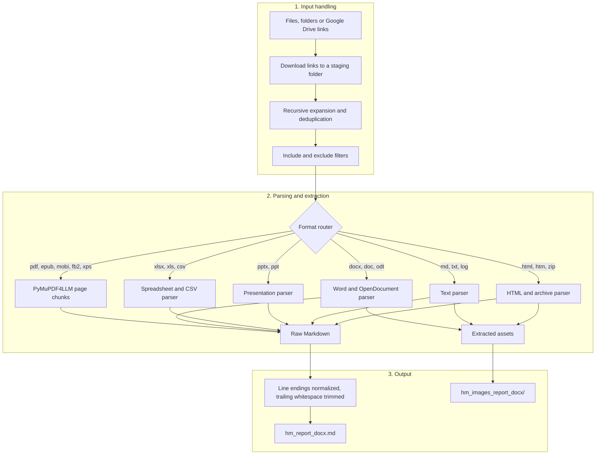
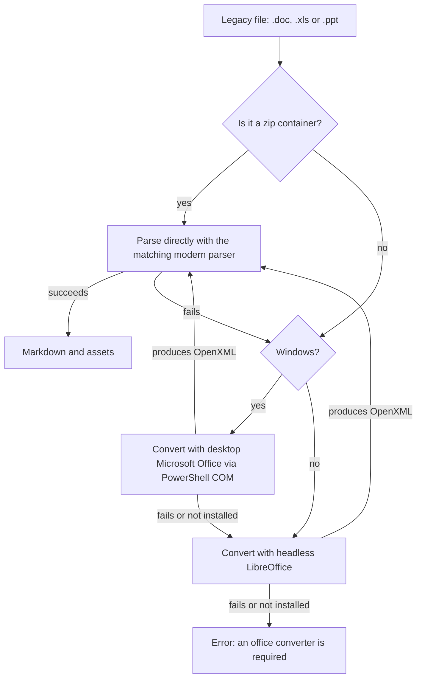

# Architecture

This document describes the high-level architecture and processing pipeline of `hammerdown`.

## Pipeline Overview

When you convert a document with `hammerdown`, processing follows three stages:

## Pipeline Stages

The conversion pipeline consists of three corresponding stages:

### 1. Input Handling

- **Input sources**: paths from the command line, a Python call, a file-manager launch, or public Google Docs and Drive links
- **CLI and Python API**: parses flags (`-i/--include`, `-e/--exclude`, `-w/--overwrite`, `-s/--skip-existing`, `-o/--output-dir`, `-m/--merge`, `--stdout`, `--confirm`, `-v/--version`) and hands the run to `run_batch`; running with no paths prints a short description instead of opening a dialog
- **Path normalization**: resolves Windows and WSL paths, strips quotes, and verifies that each path exists

### 2. Content Parsing & Extraction

- **Format router**: `parsers/CONVERTERS` maps every extension to a converter and delegates the work
- **PDF engine**: reconstructs text and layout with PyMuPDF4LLM (OCR disabled) and extracts no images
- **Word and OpenDocument engine**: extracts text and tables, translates equations (OMML and MathML) into LaTeX via `parsers/math/symbols.json`, copies OpenDocument images out, and renders Word DrawingML charts as SVG
- **Spreadsheet engine**: segments cell matrices, trims empty borders, and builds clean Markdown tables
- **Presentation engine**: converts slides, headers, and text frames into structured sections
- **Text engine**: auto-detects encodings and decodes inline base64 images into standalone image files
- **HTML and archive engine**: walks the DOM of `.html` files and of Google Drive `.zip` exports, rewriting local and base64 images into the asset folder

### 3. Post-Processing & Output

- **Asset storage**: writes SVG charts and decoded pictures to disk for the formats that expose separate assets. Converting `report.docx` creates the folder `hm_images_report_docx/` next to the source
- **Whitespace trimming and newline normalization**: converts line endings to `\n`, strips trailing whitespace on every line, and guarantees a final newline
- **File output**: writes the final Markdown document next to the source file. Converting `report.docx` creates `hm_report_docx.md`; `-w`/`--overwrite` rewrites plain-text sources in place instead

## Output Pipelines

Normal per-file output writes one Markdown document plus its asset folder next to the source: `report.docx` becomes `hm_report_docx.md` and `hm_images_report_docx/`. Two alternative pipelines reuse the same converters but assemble the results differently.

### Merged Output (`-m / --merge`)

`--merge summary.md` concatenates every successful conversion into one Markdown file:

- sources are resolved and deduplicated first, then a common root is computed across all inputs
- the target opens with a `Directory structure:` tree listing every source relative to that root
- each document is appended as a block introduced by a 48-character `=` separator, a line such as `FILE: notes/draft.md`, and the separator again, followed by the converted Markdown
- assets are redirected into a folder named after the merge target: `summary.md` uses `hm_merged_into_summary_images/`, mirroring each document's relative path, and image links are rewritten to match
- the file is written incrementally as the batch runs, so an interrupted run still leaves a usable partial document
- `--merge` rejects `--overwrite` and `--output-dir`, the target cannot also be a source, and `-s/--skip-existing` skips the whole merge when the target already exists

### Streaming to stdout (`--stdout`)

`--stdout` produces the same merged document without writing into the source tree:

- each conversion runs against a temporary output directory, so no `hm_*.md` files or asset folders are left behind
- `resources.embed_temporary_resources` inlines every temporary asset as a base64 data URI, keeping the stream self-contained
- the merged document is written to stdout while progress output is suppressed and errors go to stderr
- `--confirm` prints a preflight line with the file count, a token estimate for text sources, and the duration estimate, then asks `[y/n]`; `y` and `yes` proceed, `n` and `no` cancel, and any other answer re-asks
- without an interactive stdin, `--confirm` cancels instead of waiting

## Recursive Traversal and Filtering

Passing a directory expands it recursively, pruning directories that never hold user documents:

- directories whose name starts with `.` are skipped
- `__pycache__`, `node_modules`, `venv`, `env`, `$Recycle.Bin`, and `System Volume Information` are skipped by name
- ignored files are `~$*` office lock files, dotfiles, and previously generated `hm_*.md` outputs
- `-i/--include` narrows the scan to paths whose normalized relative path matches the regex, then `-e/--exclude` removes matches, so exclusions always win

## Interactive Progress UI

When a batch runs in a TTY, `hammerdown` renders a live view built from two Rich panels: a `Summary` panel with elapsed time, estimated time, completed count, token totals, and the error count, and a `Processing` panel showing a sliding window of the file queue.

- completed files show a `[✓]` marker styled green
- the active file shows a five-cell progress bar such as `[███░░]` styled dark orange, alongside its live elapsed time
- queued files show `[ ]` in a dim style and display their preflight estimate in the time column
- failed files show `[!]` styled red
- the `Processing` panel border uses the running color `#ec7c39` while the batch is active and the completion color `#729c1f` once it finishes

In non-TTY runs (pipes, CI, redirected logs) no live view is drawn. Each file is announced with a `Processing report.pdf ~8.1s...` line when it starts and a `Completed report.pdf (8.1s, ~1_200 tokens)` line when it finishes, and the batch ends with the `Summary`, `Error list`, and `Results` panels printed once as plain text. Errors are reported only in the error panel and never counted as results.

## Module Layout

`src/hammerdown/` is split by responsibility:

- entry points: `cli.py` (argparse parser, flag validation, dispatch to `batch`, `integrations`, and `core.updater`), `__main__.py` (the frozen-build entry point)
- orchestration: `batch/__init__.py` (`run_batch`, the coordinator hand-off, and the public `convert_files`; files are converted one at a time)
- conversion core: `core/__init__.py` (`to_markdown`, `convert_file`, `ConversionResult`, `SUPPORTED_EXTENSIONS`, and re-exports of parsers and helpers)
- input resolution: `core/discovery.py` (`expand_paths` for recursive resolution, dedup, include/exclude filters, and ignored-directory pruning; `output_paths` for the `-o` layout, which raises on filename collisions), `core/google_drive.py` (link detection, download, and title extraction)
- alternate pipelines: `core/merge.py` (`merge_root_for_inputs`, `render_merge_header`, `merge_asset_paths`, `render_merged_document`, `render_merged_markdown`, `initialize_merge_file`, `append_merged_document`), `core/stdout_mode.py` (`approximate_tokens`, `confirm_stdout`, `run_stdout_conversion`)
- estimates: `core/estimates.py` (single source of truth for the ETA via `describe`, `get_conversion_estimate_seconds`, and `get_conversion_estimate`, plus `PDF_EXTENSIONS`, `LEGACY_EXTENSIONS`, and `FAST_TEXT_EXTENSIONS`)
- support: `core/resources.py` (`embed_temporary_resources`, `token_count`), `core/path_utils.py` (`normalize_path`, `get_images_dir_name`, `enable_vt_mode`), `core/platform_utils.py` (`is_windows`, `is_macos`, `is_linux`), `core/formatting.py` (`format_duration`, `format_progress_bar`), `utils.py` (thin facade re-exporting the UI and formatting helpers for tests)
- platform integration: `core/ipc.py` (`IPCCoordinator`, `try_delegate_to_coordinator`), `core/file_selection.py` (PowerShell picker on Windows, tkinter elsewhere), `core/windows_console.py` (binds a windowed Windows process to its parent console), `core/updater.py` (`update()`, downloads verified by SHA-256 with digest and size fallbacks plus an executable magic-byte check, and a staged binary swap with rollback), `integrations/` (`install`/`uninstall`, shared helpers in `_common`, per-platform `windows`, `windows_terminal`, `macos`, `linux`)
- progress UI: `ui/batch_ui.py` (state and terminal control), `ui/batch_ui_render.py` (Rich panels and tables), `ui/ui_constants.py` (colors, widths, and layout constants)
- parsers: `parsers/__init__.py` holds the merged `CONVERTERS` registry, alongside `text`, `pdf`, `tables`, `markdown_render` (shared `render_markdown_table` and `is_math_glue`), `math/` (OMML and MathML conversion with `symbols.json`), `charts`, `odt`, `html`, `archive`, and an `office/` subpackage (`word`, `spreadsheet`, `presentation`, `legacy`)

## Cascade Parser Pipeline for Legacy Formats

Documents with legacy extensions (`.doc`, `.xls`, `.ppt`) are processed through a multi-tier fallback cascade designed primarily for execution speed and broad format compatibility.

Launching external office suites (such as LibreOffice or Microsoft Word) incurs high startup latency and system overhead. When a legacy file is really an XML archive underneath, parsing it directly in pure Python takes roughly 170 ms, while routing the same file through LibreOffice takes roughly 5,320 ms. That is a speedup of over 30x with no external software installed.

The processing cascade proceeds as follows:
1. tier 1 (fast in-memory Python parsing): inspects whether the input is a valid zip package. If parsing succeeds via `python-docx`, `openpyxl`, or `python-pptx`, conversion completes in milliseconds in pure Python
2. tier 2 (Microsoft Office automation on Windows): on Windows systems, `hammerdown` first attempts conversion using native desktop Microsoft Office (Word, Excel, or PowerPoint) via PowerShell COM automation
3. tier 3 (headless LibreOffice conversion): if Microsoft Office is unavailable or the platform is Linux/macOS, `hammerdown` invokes headless LibreOffice (`soffice`) with isolated user profiles (`-env:UserInstallation`) to export modern OpenXML formats
