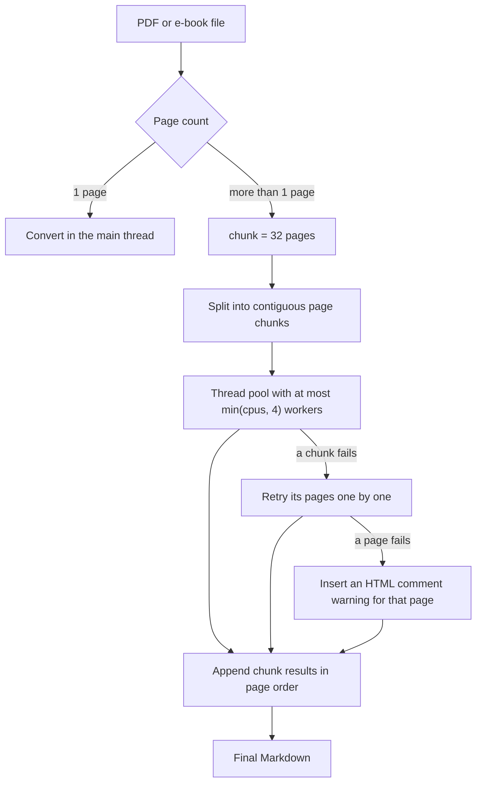

# Conversion Time Estimation and Benchmarks

This document describes the empirical benchmarks and the estimation model used by `hammerdown` to calculate estimated conversion times (ETA -- Estimated Time of Arrival) and format processing durations.

## Benchmark Results

The following measurements were gathered across standard sample inputs on a 64-bit multi-core system:

| File | Format | Size | Units | Total Time | Time per Unit |
| :--- | :--- | :--- | :--- | :--- | :--- |
| `lab1.pdf` | PDF | 104 KB | 4 pages | 2.70s | 0.68s / page |
| `lab2.pdf` | PDF | 481 KB | 7 pages | 5.69s | 0.81s / page |
| `lab3.pdf` | PDF | 80 KB | 2 pages | 1.60s | 0.80s / page |
| `lab4.pdf` | PDF | 306 KB | 3 pages | 2.89s | 0.96s / page |
| `report.pdf` | PDF | 489 KB | 9 pages | 11.35s | 1.26s / page |
| `ТЕХНИЧЕСКОЕ ЗАДАНИЕ.doc` | DOC | 55 KB | External engine convert | 5.18s | Dependent on suite startup |
| `report.doc` | DOC | 69 KB | External engine convert | 0.53s | < 1.0s total |
| `report.odt` | ODT | 75 KB | Tables, math, images | 0.05s | < 0.06s total |
| `report.docx` | DOCX | 69 KB | Tables, math, charts | 0.08s | < 0.10s total |
| `actors.xlsx` | XLSX | 20 KB | Multiple worksheets | 0.29s | < 0.35s total |
| `actors.csv` | CSV | 4.1 KB | 100 rows | 0.006s | Instantaneous |
| `LMS.md` | Markdown | 23 KB | Embedded base64 images | 0.016s | Instantaneous |
| `sample.txt` | Text | 120 B | Plain text | 0.002s | Instantaneous |

## Estimation Model

The estimation model lives in a single module, `src/hammerdown/core/estimates.py`, and both the CLI hints and the Python API helpers read from it.

The reported estimate is a preflight hint computed from document metadata only. Actual wall-clock time drops on multi-core machines because multi-page PDFs are split into page chunks and converted in parallel.

When `hammerdown` starts converting a file, it checks the structure of the file before launching CPU-heavy extraction:

### PDF and E-books

For `.pdf`, `.epub`, `.mobi`, `.fb2`, and `.xps` files, `hammerdown` reads the document catalog via PyMuPDF to count the total number of pages $N_{\text{pages}}$.

#### Parallel Chunking vs Single-Page Allocation



Because `pymupdf4llm` runs in a single stream by default, `hammerdown` takes over PDF chunking logic to parallelize conversion while keeping memory use bounded:

- workload chunking: pages are divided into continuous blocks of 32 pages rather than individual isolated pages
- concurrent execution: page chunks are dispatched to a `ThreadPoolExecutor` with at most `min(cpu_count, 4)` worker threads

For single-page documents ($N_{\text{pages}} = 1$), execution runs directly in the main thread to eliminate thread scheduling overhead.

#### Why Per-Page Worker Dispatch is Inefficient

Distributing PDF extraction page-by-page (1 page per worker) introduces overhead compared to balanced continuous chunks:

1. **Document re-opening cost**: each isolated `to_markdown(pages=[i])` call forces PyMuPDF4LLM to re-parse the document catalog, font tables, and XREF entries. Processing 100 pages individually re-initializes document metadata 100 times, whereas fixed 32-page chunks re-initialize it only four times.
2. **Context preservation and layout continuity**: multi-page tables, continuous code blocks, and running headers spanning page boundaries are accurately merged when adjacent pages remain in the same chunk.
3. **Queue and GIL overhead**: dispatching thousands of micro-tasks saturates thread pool queues without adding extra parallelism beyond physical CPU core capacity.

Empirical benchmark comparison on `report.pdf` (9 pages, 12-core CPU):

| Strategy | Total Duration | Metadata Re-initializations | Layout Continuity |
| :--- | :--- | :--- | :--- |
| **Sequential (PyMuPDF4LLM default)** | 11.35s | 1 | Preserved |
| **Per-Page Worker Allocation (1 page / task)** | 9.76s | 9 | Fragmented across pages |
| **Balanced Page Chunking (hammerdown)** | **9.29s** | **4** | **Preserved within chunks** |

#### Estimation Formula

Because PyMuPDF4LLM performs layout analysis and reading-order reconstruction across chunks, single-core duration per page averages 0.85--1.00 seconds. The baseline ETA estimation formula reflects single-stream bounds:

$$\text{Estimated Time} = \max(1.0,\; N_{\text{pages}} \times 0.9)$$

On multi-core CPUs, concurrent chunk execution shortens wall-clock time until the worker cap is reached. Measured 30-page runs did not improve when the internal cap was raised from 4 to 10, so the cap stays at 4.

Example log:
```text
Processing report.pdf (9 pages, est. ~8.1s)...
Completed report.pdf in 10.0s (0 images)
```

### Presentations

For `.pptx` slides, `hammerdown` inspects slide count $N_{\text{slides}}$ by counting `ppt/slides/slide*.xml` members inside the archive:

$$\text{Estimated Time} = \max(1.0,\; N_{\text{slides}} \times 0.2)$$

### Other Formats

Structured office documents and text are parsed directly from their XML archives or raw bytes, so the estimate is derived from cheap metadata:

- `.docx`: $\max(1.0, N_{\text{pages}} \times 0.4)$ when `docProps/app.xml` reports a page count, otherwise $\max(1.0, \text{size of } \texttt{word/document.xml} / 50000)$
- `.xlsx`: $\max(1.0, N_{\text{sheets}} \times 0.5)$
- `.odt`: $\max(1.0, \text{size of } \texttt{content.xml} / 50000)$
- plain text (`.txt`, `.md`, `.log`, `.csv`): a flat `0.5` seconds with a "fast text conversion" hint

Multi-threading is intentionally restricted to PDF documents:
- PDF files require visual page-layout reconstruction, font raster analysis, and vector curve extraction (~0.8--1.0s per page), making multi-threaded page chunking essential for responsive processing
- structured office documents (`.docx`, `.odt`, `.xlsx`) parse nearly instantaneously (<0.1s total), so introducing thread scheduling overhead would degrade rather than improve conversion speed
- batch conversion runs through a bounded in-process pipeline, not a sequential loop and not multi-process parallelism

#### Batch Scheduler Policy

The batch scheduler keeps a small in-flight window of conversions and commits staged results in input order, so a fast file does not jump ahead of an earlier slow file in the user-visible output.

Concurrency bounds are separate by resource type:
- `heavy` covers formats that perform substantial parsing in native extensions
- `pdf` covers `.pdf`, `.epub`, `.mobi`, `.fb2`, and `.xps`, because they all use the same page-pool parser; the default is one PDF-like job at a time
- `legacy` covers `.doc`, `.xls`, and `.ppt`, which drive external office applications; the default is one legacy job at a time
- text formats do not consume heavy permits

The PDF permit is separate from the heavy permit on purpose. A PDF job that is waiting for the PDF slot must not occupy a heavy slot needed by a DOCX or XLSX job, otherwise a queue of PDFs can starve non-PDF work.


#### Specialized Output Modes

The IPC coordinator and the conversion scheduler are separate layers. The coordinator aggregates inputs from multiple launches; the bounded scheduler controls ordinary per-file conversion jobs. The current mode matrix is:

| Mode | IPC coordinator | Bounded scheduler | Output behavior |
| :--- | :--- | :--- | :--- |
| ordinary per-file conversion | optional in coordinator mode | yes | staged results committed in input order |
| `merge` | optional in coordinator mode | no | sequential merge session appends one ordered target |
| `tree` | optional in coordinator-capable launchers | no | tree discovery followed by the ordered merge path |
| `stdout` | explicitly disallowed | no | sequential conversion writes Markdown directly to stdout |

`merge` and `tree` could be moved onto a concurrent staged-results pipeline, but that requires ordered target writes, isolated asset namespaces, cancellation rules, and atomic final publication. `stdout` has an additional ownership constraint: one process must own the output stream, so coordinator support would need an explicit result protocol instead of allowing multiple processes to write to stdout.

#### Warm-up Decision

No production pre-warm step is enabled. The available Office benchmark used three fresh CLI processes (`1.168s`, `1.110s`, and `1.445s` for the same legacy document), so it cannot separate Python startup, Office startup, filesystem cache, and converter warm-up. The PDF worker-cap and chunk-size experiments also used separate processes with alternating order to reduce cache bias; they were not controlled cold-versus-warm preheat experiments.

The evidence does not show a repeatable user-visible benefit that would justify launching a dummy PDF or Office conversion before the real work. Keep warm-up as a future experiment only if a controlled cold/warm benchmark measures startup, peak memory, cancellation, and total end-to-end time separately.

A later controlled probe (see the work-unit matrix section) separated the startup cost itself: `hammerdown.cli` imports in about 0.3s, and the `pymupdf`/`pymupdf4llm` import adds about 2.1s of cold-process time. The pre-warm conclusion is unchanged; the actionable finding is that the import cost, not conversion warm-up, dominates small-file runs.

#### Measured Batch and PDF Worker Limits

Measurements used the first 30 pages of an 812-page PDF on a 12-core machine. The full file was never converted. Each cell ran in a separate process, chunk boundaries were identical, and run order alternated to reduce warm-cache bias.

| PDF worker cap | Runs | Median | Chunks | Output parity |
| :--- | :--- | :--- | :--- | :--- |
| 4 | 29.64s, 30.08s, 30.32s, 31.90s | 30.20s | 10 | SHA-256 matched |
| 10 | 26.86s, 30.01s, 30.21s, 48.21s | 30.11s | 10 | SHA-256 matched |

Peak resident memory in a separate pair of runs was 349.5 MB at cap 4 and 357.3 MB at cap 10. The medians differ by less than 0.3%, while the slowest cap-10 run took 48.2s. Raising the cap therefore produced no stable speedup and slightly more variance.

Two PDFs converted at the same time with the outer scheduler also showed no stable gain:

| Outer workers (inner cap 4) | Runs |
| :--- | :--- |
| 1 | 60.84s, 49.75s, 46.71s |
| 2 | 58.82s, 51.68s, 50.21s |

Both configurations produced identical output hashes. This is why the default keeps one PDF-like job active at a time; it is a conservative bound, not a claim that one is optimal on every machine.

These numbers come from a 30-page sample, so they bound thread and memory behavior rather than predict full-book duration. Do not treat cap 4 as a tuned optimum on every CPU; it is a resource bound that showed no measurable time penalty in these runs.

#### Mixed-Batch In-Flight Window

The scheduler was also measured against the 13 supported inputs in `tests/inputs`, including PDFs, legacy Office documents, DOCX, ODT, XLSX, CSV, Markdown, and text. Each configuration used a separate process, the same inputs, full output hashing, and the same worker limit as its in-flight limit:

| In-flight / workers | Runs | Pooled median | Output parity |
| :--- | :--- | :--- | :--- |
| 1 | 39.72s, 38.11s, 32.64s, 33.34s | 35.73s | all matched |
| 2 | 33.84s, 31.50s, 34.76s, 32.78s | 33.31s | all matched |
| 4 | 29.83s, 33.40s, 32.17s, 34.27s | 32.78s | all matched |

The four-worker median was only 0.53s, or 1.6%, below the two-worker median, and it won only two of four paired comparisons. This is not enough evidence to change the default. The scheduler therefore keeps `in_flight_limit=2` as a conservative general-purpose setting. It is a measured default, not a universal optimum.

A separate three-run legacy benchmark on `tests/inputs/report.doc` took 1.168s, 1.110s, and 1.445s, with identical output hashes. Each run started a new CLI process, so these numbers include Python and Office-engine startup and cannot distinguish process warm-up from OS or filesystem cache effects. They do not justify Office prewarming. The successful engine was not identified by the benchmark, because both the Microsoft Word COM and LibreOffice fallback paths are available on the machine.

#### Why the Scheduler Does Not Yet Use a Unified Work-Unit Queue

> [!note]
> Status update: the unified design described below is now implemented as `WorkUnitScheduler` and runs in production for batch jobs containing real PDFs, including merge and tree modes. The hazards listed here were the design contract it had to satisfy: bounded chunk admission, ordered assembly, per-file staging boundaries, and cancellation that never commits late results. The measurements above constrain its chunk policy; the worker bound stays dynamic.

A possible future design is a single batch queue containing one task per ordinary file and several page-range tasks per PDF. For example, five PDFs with four chunks each could contribute 20 page tasks, while Word and text documents remain whole-file tasks. A global budget could then lend unused capacity between files instead of maintaining nested per-file pools.

This is not enabled yet. Keeping the current per-file staging and commit boundary is safer until a prototype proves a benefit on mixed workloads. A naive implementation is unsafe because:

- a PDF parent that waits for its own chunks in the same bounded pool can deadlock when all workers are occupied by waiting parents
- a FIFO queue can starve ordinary files behind all chunks from one large PDF
- chunks must be assembled by page range, while files and merge inputs must still be committed in input order
- cancellation must wait for active native calls to stop before deleting staging; queued work must not commit late results
- a global worker count alone does not bound memory or native-library thread usage

If the unified design is revisited, the first implementation should use a batch-scoped scheduler with non-blocking PDF coordinators, bounded chunks admitted round-robin per file, one global work budget, and the existing per-file staging/commit boundary. Word and text documents should remain whole-file tasks unless their converters gain a safe independent split point. Before enabling it, compare the current scheduler with the prototype on a mixed set containing short two-page PDFs, longer PDFs, and ordinary files, recording total time, per-file latency, peak RSS, fairness, cancellation behavior, and output hashes.

A two-page PDF is not split into two parallel tasks by the current implementation. The split branch is selected because `page_count > 1`, but `chunk_size` is at least two, so the document becomes one two-page chunk and uses one worker. Single-page PDFs bypass the pool entirely. The current PDF split is based on page count, not line count.

#### Chunk-Size Experiment on a Large-Document Sample

A benchmark converted the first 270 pages of an 812-page Harris PDF; the full book was not converted. The extracted sample is 10,352,509 bytes with SHA-256 `67507383b2ea31388633e0524ad45dbbca02dafcebf6046f2877483f49852cea`. The retained matrix records a 12-core host, worker cap 4, page ranges, output sizes, and hashes. The sample hash and the successful current, fixed-32, and fixed-64 outputs were independently checked against the retained files. Each policy was run three times in separate processes, with sequential and reverse ordering to reduce warm-cache bias.

| Chunk policy | Chunks | Runs | Median | Output SHA-256 | Status |
| :--- | ---: | :--- | ---: | :--- | :--- |
| CPU-derived policy, 23 pages on this host | 12 | 293.731s, 267.162s, 244.943s | 267.162s | `9b510327bc7cecc40903ea82ae419b1ee10b0b33f11f711c7e09bf7fd191b1` | verified retained output |
| fixed 32 pages | 9 | 245.189s, 238.291s, 218.543s | 238.291s | `ef5b286d3f62fb907a50019efde43c35b60e3aec6364709e43efaeb494f4c990` | verified retained output |
| fixed 64 pages | 5 | 388.528s | -- | `e34e42af615d9b3c12ec2a2ac2204a5fd8bb4222bc309da5661a5a243c0c27e9` | exploratory comparison only |
| fixed 96 pages | -- | -- | -- | -- | excluded: timeout report and retained file do not match |

A bounded line comparison of the three valid outputs found 7,060 lines in each. After normalizing Markdown heading depth, the nonblank line sequences are identical, and all non-heading lines match exactly. Heading depth differs in 140 lines for fixed 32 pages (110 headings moved to a shallower level and 30 to a deeper level) and 240 lines for fixed 64 pages (all moved to a shallower level). This is a Markdown structure difference, not evidence of missing or reordered prose. The outputs are final concatenations, not per-chunk artifacts, so the changes cannot yet be mapped to specific seams or classified as caused by the chunk boundary.

The old fixed-96 harness used `subprocess.run(timeout=...)` without verified process-tree cleanup, and its retained Markdown does not match the metadata. Exclude that artifact. The new private harness has a unique attempt directory, validates exit status and output hashes, and has passed parent/descendant timeout tests; no new large Harris benchmark has been run with it yet.

Switch the production default to fixed 32-page chunks. Across three safe runs, the median was 238.291s versus 267.162s for the CPU-derived policy, an improvement of about 11%, and the fixed-32 output hash was stable. The valid outputs contain the same prose after heading-depth normalization, with no missing, duplicated, or reordered content found. Heading-depth differences remain a documented fidelity caveat, and the result is based on a 270-page sample rather than the full 812-page book. No production Markdown joiner is justified.

The verified implementation contract is page-based chunking, ordered assembly, and a four-worker cap. A two-page PDF enters the chunking branch but remains one chunk containing pages 0 and 1, so it uses one worker; a single-page PDF bypasses the executor. A regression test now checks the two-page boundary explicitly.

#### Work-Unit Scheduler Chunk and Worker Matrix (180-page PDF)

A second matrix ran on a Windows laptop with an Intel i7-1355U (2 P-cores + 8 E-cores, 12 threads) against a 180-page mixed-content PDF converted through the production CLI (`python -m hammerdown <file> -o <dir>`), one subprocess per attempt, strictly sequential scheduling, a 300 s hard per-attempt timeout, psutil process-tree peak-RSS sampling, and three attempts per configuration. The chunk size and worker count were injected through `HAMMERDOWN_PDF_CHUNK_PAGES` and `HAMMERDOWN_WORKERS`; `HAMMERDOWN_FORCE_SEQUENTIAL=1` produced the legacy-path baseline. Every successful attempt across every configuration produced the identical output SHA-256 `b34e675dfe1777beed91146c3a872b1d514cfeb1a01f27e2057dcbfc1bf3cf5f`.

| Chunk pages | Attempts | Median | Min | Max | Peak RSS | Note |
| :--- | ---: | ---: | ---: | ---: | ---: | :--- |
| 8 | 3 | 204.5s | 199.5s | 207.6s | 364 MB | |
| 16 | 3 | 204.5s | 202.1s | 217.6s | 367 MB | |
| 24 | 3 | 206.3s | 202.4s | 217.8s | 375 MB | |
| 32 | 3 | 204.3s | 199.9s | 223.1s | 381 MB | |
| 48 | 3 | 205.7s | 204.2s | 210.4s | 398 MB | |
| 64 | 3 | 198.4s | 188.5s | 203.7s | 412 MB | fastest median, within noise of 32 |
| 100 | 3 | -- | -- | -- | -- | 3 of 3 exceeded the 300 s cap |
| legacy sequential path | 3 | 232.2s | 228.4s | 239.4s | 422 MB | internal 32-page chunks, cap 4 |

Every median between 8 and 64 pages sits inside a 4% band, which is the size of the within-configuration spread, while peak RSS grows monotonically from 364 MB to 412 MB as chunks enlarge. The 100-page default that shipped unmeasured in the work-unit scheduler was the only configuration that could not finish inside the 300 s budget, so it was slower than even the sequential path on this host. The production default is therefore fixed 32-page chunks, matching the earlier Harris-sample decision, the converter constant in `parsers/pdf.py`, and the documented behavior in `ARCHITECTURE.md` and `TECHNICAL.md`.

| Workers at 64-page chunks | Attempts | Median | Min | Max | Peak RSS |
| :--- | ---: | ---: | ---: | ---: | ---: |
| 2 | 3 | 187.6s | 184.7s | 190.7s | 414 MB |
| 4 | 3 | 215.4s | 201.8s | 289.3s | 415 MB |
| 6 | 2 | 232.5s | 174.3s | 290.7s | 413 MB |
| 8 | 3 | 188.4s | 181.0s | 251.2s | 412 MB |

The worker sweep shows no monotonic trend: two and eight workers land within 0.5s of each other, while four and six look slower with spreads up to 63%. With only three 64-page chunks in the document, caps above three cannot add parallelism anyway, and the variance is dominated by P/E-core placement on this laptop. No fixed worker count is justified; the scheduler keeps the dynamic RAM-aware `calculate_optimal_workers` bound with its 700 MB system reserve.

The warm-up probe measured cold interpreter startup separately: importing `hammerdown.cli` costs about 0.3s median (37 MB), while additionally importing `pymupdf` and `pymupdf4llm` costs about 2.1s median (151 MB). That two-second fixed cost is under 1% of a large conversion, but it dominates single small-file CLI runs, which argues for import laziness rather than for any pre-warm conversion step.

A follow-up worker sweep at 32-page chunks was started but discarded: concurrent maintenance work on the same laptop polluted its attempts (all attempts hit the 300 s cap), which is exactly the measurement hygiene the earlier sections warn about. Benchmarks must run with the machine otherwise idle.

#### Work-Unit Scheduler Matrix (812-page PDF)

The retained Harris sample (812 pages, 30.8 MB) ran through the production CLI with the work-unit scheduler, one subprocess per attempt and no other load on the host. The PDF-concurrency limit was injected through `HAMMERDOWN_PDF_LIMIT`; the chunk size through `HAMMERDOWN_PDF_CHUNK_PAGES`.

| Configuration | Attempts | Median | Peak RSS | Note |
| :--- | ---: | ---: | ---: | :--- |
| chunk 16, pdf limit 2 | 1 | 732.3s | 681 MB | single run |
| chunk 32, pdf limit 2 | 2 | 663.5s | 676 MB | fastest median |
| chunk 64, pdf limit 2 | 2 | 689.7s | 679 MB | 4% behind 32 |
| chunk 32, pdf limit 4 | 2 | 758.0s | 701 MB | 14% behind limit 2 |
| chunk 32, pdf limit 6 | 1 | 691.4s | 724 MB | single run |

Chunk 32 with a PDF limit of 2 is the best repeated configuration, matching the 180-page result. Raising the PDF limit to 4 or 6 is slower despite more in-flight chunks, and peak RSS is nearly flat across chunk sizes at about 680 MB, so memory pressure is set by the document, not by the chunk policy.

#### Outer Concurrency Does Not Add PDF Throughput

A controlled micro-benchmark isolated the question by converting identical 16-page chunks of the 812-page sample with one Python thread, two Python threads, and 2- or 4-process pools, sampling process-tree CPU time and RSS every 50 ms.

| Configuration | Wall | CPU | CPU/wall | Peak RSS |
| :--- | ---: | ---: | ---: | ---: |
| one 16-page chunk, 1 thread | 13.9s | 151.6s | 10.9 | 391 MB |
| two chunks back-to-back, 1 thread | 28.7s | 293.9s | 10.2 | 391 MB |
| two chunks, 2 threads | 29.9s | 302.2s | 10.1 | 391 MB |
| 64 pages, 1 thread, 3 reps | 56.9-76.1s | 598.6-691.4s | 9.1-10.5 | 395-489 MB |
| 64 pages, 2 threads, 2 reps | 63.5-123.9s | 555.5-875.2s | 7.1-8.8 | 402-454 MB |
| 64 pages, 4 threads, 2 reps | 101.8-111.3s | 777.2-818.0s | 7.4-7.6 | 424-476 MB |
| 64 pages, 2 processes, 2 reps | 51.7-68.7s | 607.7-667.3s | 11.7-11.8 | 856.7-863.6 MB |
| 64 pages, 4 processes, 2 reps | 57.4-60.5s | 680.3-714.0s | 11.8 | 1.34-1.35 GB |

Two threads converted two 16-page chunks in 29.9s against 28.7s back-to-back on one thread, a 0.96x ratio, so outer thread parallelism contributes nothing here. The decisive number is CPU/wall: a single-threaded `pymupdf4llm.to_markdown` call already consumes about 10 CPU-seconds per wall-second, which means the native layer saturates roughly ten of the twelve hardware threads inside one call. Extra Python threads only oversubscribe those cores, and process pools add 0.4-1.0 GB of RSS without a repeatable wall-time win.

This is why the measured matrix above prefers a PDF limit of 2 and why raising it hurts. The remaining lever for very large PDFs is per-page cost inside PyMuPDF, not hammerdown's dispatch width.

#### Many-Small-Files Batch

A 120-file batch (100 tiny `.txt`, 15 `.doc`, 5 `.docx`) converts in 4.8s end to end on the same laptop, and every Word output is real content: 16,298-16,299 bytes, 2,357 words and one image each, with no warning stubs. `.doc` goes through Microsoft Office COM with LibreOffice as fallback.

| Subset | Files | Wall, rc 0 | Per file |
| :--- | ---: | ---: | ---: |
| `.txt` only | 100 | 1.3s | 13 ms |
| `.doc` only | 15 | 2.3s | 153 ms |
| full batch | 120 | 4.8s | 40 ms |

The CLI imports in 0.43s and does not load PyMuPDF at all when the batch has no PDF, so the 2.1s import cost measured for PDF runs does not apply to this workload. Each `.doc` currently pays for its own PowerShell process and Word COM instance, about 0.1s of the 153 ms; sharing one Word instance across the batch is the only visible further saving and is worth under a second on 15 files.

### Why Outer Python Threading Is Not the Parallelism Here

Python's **Global Interpreter Lock (GIL)** limits parallel execution of Python bytecode within one process, but the measured constraint on this host is not the GIL alone. A single-threaded `pymupdf4llm.to_markdown` call consumes about 10 CPU-seconds per wall-second, so the native layer already runs on many cores inside one call. Adding a second Python thread to convert a second chunk yields 0.96x the throughput of running the same chunks back-to-back, and a 2- or 4-process pool adds 0.4-1.0 GB of RSS without a repeatable wall-time win. `hammerdown` therefore keeps outer PDF dispatch bounded at two concurrent chunks and lets PyMuPDF's internal threading supply the core utilization.

For legacy binary office formats (`.doc`, `.xls`, `.ppt`), conversion timing depends on external application initialization times. The baseline ETA estimation uses a 10.0s baseline:

$$\text{Estimated Time} = 10.0 + (\text{Size in MB} \times 2.0)$$

### Preflight Estimate for `--stdout`

`--confirm` reuses the same estimation module, so the numbers shown before a stream match the per-file hints in the batch UI:

- the duration is the sum of the known per-file estimates. Files without an estimate are skipped rather than turning the whole total into `unknown`; the total is `unknown` only when no file has one
- the token count is reported only for formats that are already plain text (`.txt`, `.md`, `.log`, `.csv`), where `max(1, total bytes / 4)` is a fair proxy for the converted Markdown. A PDF, DOCX, or XLSX is mostly compressed payload, so its byte size would overstate the result by an order of magnitude. For mixed inputs the clause is marked `from text sources`, and when no such files are present it is omitted
- the line is printed to stderr before any conversion work starts, for example `Preflight: 13 files, ~39_489 tokens, estimated time ~6.5s.`

## Human-Readable Duration Formatting

Conversion durations are displayed in human-readable notation rather than raw seconds:

- under 1 minute: one decimal place, for example `0.5s` or `45.1s`
- under 1 hour: minutes plus one decimal place of seconds, for example `1m 35.7s` or `12m 4.0s`
- 1 hour and above: hours and whole minutes, for example `1h 30m` or `2h 0m`

## Alternative Runtimes Investigation (Go and Rust)

During Stage 8 architectural planning, empirical benchmarks were performed to test whether offloading process coordination or core logic to Go or Rust provides a measurable performance benefit.

### 1. Finite State Machine (Rust vs Python)

A synthetic benchmark tested execution speed on a deterministic finite state machine (1,000,000 events per iteration across 10 iterations) running on Linux (WSL Ubuntu):

| Metric | Python 3.14 | Rust 1.99 (Release) | Difference |
| :--- | :--- | :--- | :--- |
| Warm throughput | 32.38M events/s | 130.62M events/s | 4.04x speedup |
| Cold process start (median) | 201.86ms | 19.47ms | 10.37x faster |

While Rust is substantially faster at pure algorithmic state evaluation, this does not translate to document conversion. In `hammerdown`, over 95% of wall-clock time is spent inside compiled C libraries (`PyMuPDF`, `onnxruntime`, XML parsers) and disk I/O. Rewriting the Python layer in Rust would save less than 0.3s on a 30s batch while adding build complexity, toolchain requirements, and cross-platform binary packaging overhead.

### 2. Process Coordinator (Go vs Python)

A benchmark evaluated process supervision and job dispatch overhead comparing a Go coordinator against a Python coordinator controlling long-lived Python worker processes.

On a synthetic benchmark with small payload roundtrips:
- 100 jobs: Go and Python performed identically (1.00x--1.03x speedup).
- 2,000 jobs: Go was 1.15x--1.28x faster in queue dispatch overhead.

However, when tested against the actual 13-document fixture suite (`tests/inputs`) containing real PDF, DOCX, XLSX, ODT, and text files:

| Workers | Python Coordinator (Median) | Go Coordinator (Median) | Ratio | Output Parity (SHA-256) |
| :--- | :--- | :--- | :--- | :--- |
| 1 worker | 34.38s | 32.62s | 1.054x | 13 / 13 matched |
| 2 workers | 39.22s | 39.00s | 1.005x | 13 / 13 matched |
| 4 workers | 39.51s | 39.65s | 0.996x | 13 / 13 matched |

### Conclusion on External Languages

1. Heavy document operations (PDF layout parsing, OCR, table extraction, DOCX conversion) dominate total duration. Supervision overhead between Go and Python accounts for under 1% of total batch runtime.
2. Launching external CLI processes per file introduces 0.5s--1.0s of interpreter and C-extension startup overhead per invocation. A single batch process or long-lived worker pool is significantly faster than spawning separate CLI instances.
3. Introducing Go or Rust sidecars creates deployment friction, multi-platform compilation requirements, and PyInstaller bundling issues without providing user-visible conversion speedups.
4. The verified path for performance scaling in `hammerdown` is in-process concurrent task scheduling (`ThreadPoolExecutor` bounded by CPU/format requirements) using existing Python boundaries.
