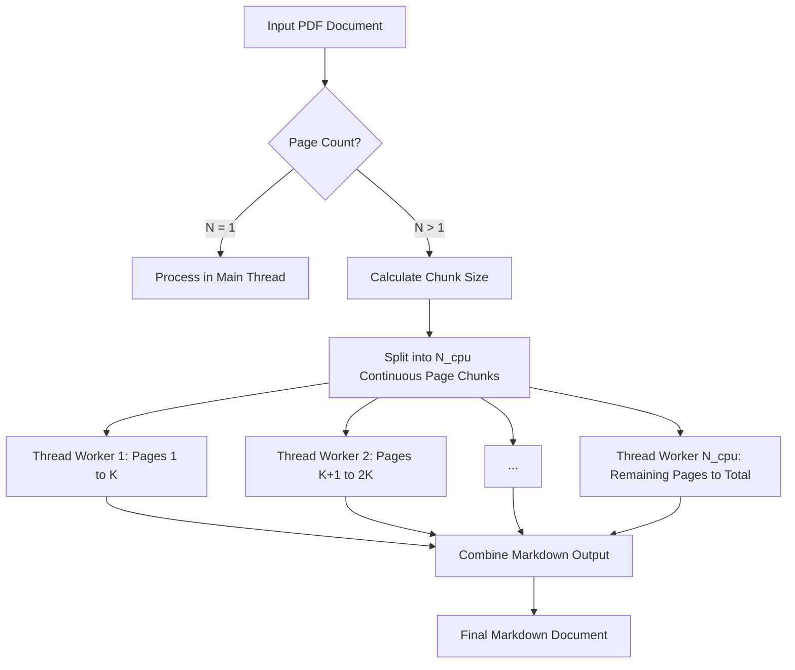

# Conversion Time Estimation and Benchmarks

This document describes the empirical benchmarks and the estimation model used by `hammerdown` to calculate estimated conversion times (ETA -- Estimated Time of Arrival) and format processing durations.

## Benchmark Results

The following measurements were gathered across standard sample inputs on a 64-bit multi-core system:

| File | Format | Size | Units | Total Time | Time per Unit |
| :--- | :--- | :--- | :--- | :--- | :--- |
| `lab1.pdf` | PDF | 104 KB | 4 pages | 2.70s | 0.68s / page |
| `lab2.pdf` | PDF | 481 KB | 7 pages | 5.69s | 0.81s / page |
| `lab3.pdf` | PDF | 80 KB | 2 pages | 1.60s | 0.80s / page |
| `lab4.pdf` | PDF | 306 KB | 3 pages | 2.89s | 0.96s / page |
| `report.pdf` | PDF | 489 KB | 9 pages | 11.35s | 1.26s / page |
| `ТЕХНИЧЕСКОЕ ЗАДАНИЕ.doc` | DOC | 55 KB | External engine convert | 5.18s | Dependent on suite startup |
| `report.doc` | DOC | 69 KB | External engine convert | 0.53s | < 1.0s total |
| `report.odt` | ODT | 75 KB | Tables, math, images | 0.05s | < 0.06s total |
| `report.docx` | DOCX | 69 KB | Tables, math, charts | 0.08s | < 0.10s total |
| `actors.xlsx` | XLSX | 20 KB | Multiple worksheets | 0.29s | < 0.35s total |
| `actors.csv` | CSV | 4.1 KB | 100 rows | 0.006s | Instantaneous |
| `LMS.md` | Markdown | 23 KB | Embedded base64 images | 0.016s | Instantaneous |
| `sample.txt` | Text | 120 B | Plain text | 0.002s | Instantaneous |

## Estimation Model

The estimation model lives in a single module, `src/hammerdown/estimates.py`, and both the CLI hints and the Python API helpers read from it.

The reported estimate is a preflight hint computed from document metadata only. Actual wall-clock time drops on multi-core machines because multi-page PDFs are split into page chunks and converted in parallel.

When `hammerdown` starts converting a file, it checks the structure of the file before launching CPU-heavy extraction:

### PDF and E-books

For `.pdf`, `.epub`, `.mobi`, `.fb2`, and `.xps` files, `hammerdown` reads the document catalog via PyMuPDF to count the total number of pages $N_{\text{pages}}$.

#### Parallel Chunking vs Single-Page Allocation



Because `pymupdf4llm` runs in a single stream by default, `hammerdown` takes over PDF chunking logic to parallelize conversion across all available CPU cores:

- workload chunking: pages are divided into continuous page blocks of size $\max(2, \lceil N_{\text{pages}} / N_{\text{cpu}} \rceil)$ rather than individual isolated pages
- concurrent execution: page chunks are dispatched to a `ThreadPoolExecutor` with up to $N_{\text{cpu}}$ worker threads

For single-page documents ($N_{\text{pages}} = 1$), execution runs directly in the main thread to eliminate thread scheduling overhead.

#### Why Per-Page Worker Dispatch is Inefficient

Distributing PDF extraction page-by-page (1 page per worker) introduces overhead compared to balanced continuous chunks:

1. **Document re-opening cost**: each isolated `to_markdown(pages=[i])` call forces PyMuPDF4LLM to re-parse the document catalog, font tables, and XREF entries. Processing 100 pages individually re-initializes document metadata 100 times, whereas chunking by CPU core count re-initializes it only $N_{\text{cpu}}$ times.
2. **Context preservation and layout continuity**: multi-page tables, continuous code blocks, and running headers spanning page boundaries are accurately merged when adjacent pages remain in the same chunk.
3. **Queue and GIL overhead**: dispatching thousands of micro-tasks saturates thread pool queues without adding extra parallelism beyond physical CPU core capacity.

Empirical benchmark comparison on `report.pdf` (9 pages, 12-core CPU):

| Strategy | Total Duration | Metadata Re-initializations | Layout Continuity |
| :--- | :--- | :--- | :--- |
| **Sequential (PyMuPDF4LLM default)** | 11.35s | 1 | Preserved |
| **Per-Page Worker Allocation (1 page / task)** | 9.76s | 9 | Fragmented across pages |
| **Balanced Page Chunking (hammerdown)** | **9.29s** | **4** | **Preserved within chunks** |

#### Estimation Formula

Because PyMuPDF4LLM performs layout analysis and reading-order reconstruction across chunks, single-core duration per page averages 0.85--1.00 seconds. The baseline ETA estimation formula reflects single-stream bounds:

$$\text{Estimated Time} = \max(1.0,\; N_{\text{pages}} \times 0.9)$$

On multi-core CPUs, concurrent chunk execution accelerates actual wall-clock processing time proportionally to available CPU cores and page count.

Example log:
```text
Processing report.pdf (9 pages, est. ~8.1s)...
Completed report.pdf in 10.0s (0 images)
```

### Presentations

For `.pptx` slides, `hammerdown` inspects slide count $N_{\text{slides}}$ by counting `ppt/slides/slide*.xml` members inside the archive:

$$\text{Estimated Time} = \max(1.0,\; N_{\text{slides}} \times 0.2)$$

### Other Formats

Structured office documents and text are parsed directly from their XML archives or raw bytes, so the estimate is derived from cheap metadata:

- `.docx`: $\max(1.0, N_{\text{pages}} \times 0.4)$ when `docProps/app.xml` reports a page count, otherwise $\max(1.0, \text{size of } \texttt{word/document.xml} / 50000)$
- `.xlsx`: $\max(1.0, N_{\text{sheets}} \times 0.5)$
- `.odt`: $\max(1.0, \text{size of } \texttt{content.xml} / 50000)$
- plain text (`.txt`, `.md`, `.log`, `.csv`): a flat `0.5` seconds with a "fast text conversion" hint

Multi-threading is intentionally restricted to PDF documents:
- PDF files require visual page-layout reconstruction, font raster analysis, and vector curve extraction (~0.8--1.0s per page), making multi-threaded page chunking essential for responsive processing
- structured office documents (`.docx`, `.odt`, `.xlsx`) parse nearly instantaneously (<0.1s total), so introducing thread scheduling overhead would degrade rather than improve conversion speed
- batch conversion across files runs sequentially in a single loop, so there is no multi-process parallelism; the only thread pools in the project are the PDF page-chunk pool and the golden-test pool

### Why Python Multi-threading is Real Parallelism Here

Python's **Global Interpreter Lock (GIL)** limits parallel execution of Python bytecode within a process. `hammerdown` processes PDF page chunks in worker threads, while PyMuPDF and PyMuPDF4LLM perform much of the expensive parsing in compiled native code:

- calls into those extensions can release the **GIL** during native operations such as layout parsing, font rasterization, and vector path decoding
- separate page chunks are dispatched to worker threads by the PDF converter, allowing native parsing work to use multiple CPU cores

For legacy binary office formats (`.doc`, `.xls`, `.ppt`), conversion timing depends on external application initialization times. The baseline ETA estimation uses a 10.0s baseline:

$$\text{Estimated Time} = 10.0 + (\text{Size in MB} \times 2.0)$$

### Preflight Estimate for `--stdout`

`--confirm` reuses the same estimation module, so the numbers shown before a stream match the per-file hints in the batch UI:

- the duration is the sum of the known per-file estimates. Files without an estimate are skipped rather than turning the whole total into `unknown`; the total is `unknown` only when no file has one
- the token count is reported only for formats that are already plain text (`.txt`, `.md`, `.log`, `.csv`), where `max(1, total bytes / 4)` is a fair proxy for the converted Markdown. A PDF, DOCX, or XLSX is mostly compressed payload, so its byte size would overstate the result by an order of magnitude. For mixed inputs the clause is marked `from text sources`, and when no such files are present it is omitted
- the line is printed to stderr before any conversion work starts, for example `Preflight: 13 files, ~39_489 tokens, estimated time ~6.5s.`

## Human-Readable Duration Formatting

Conversion durations are displayed in human-readable notation rather than raw seconds:

- under 1 minute: one decimal place, for example `0.5s` or `45.1s`
- under 1 hour: minutes plus one decimal place of seconds, for example `1m 35.7s` or `12m 4.0s`
- 1 hour and above: hours and whole minutes, for example `1h 30m` or `2h 0m`
